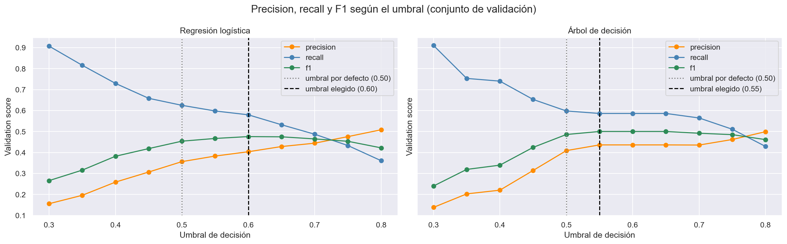
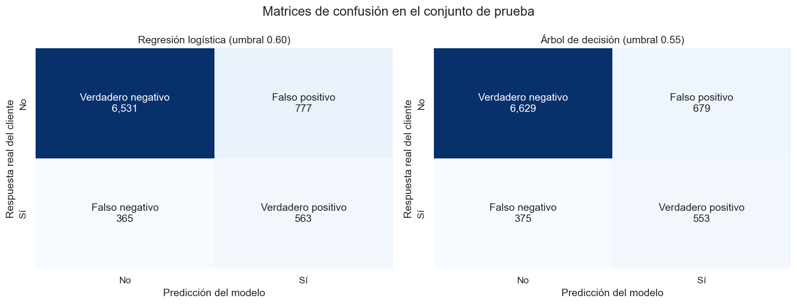
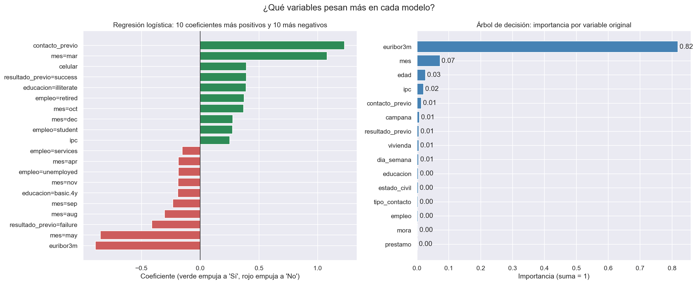
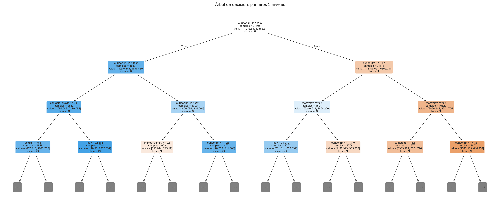
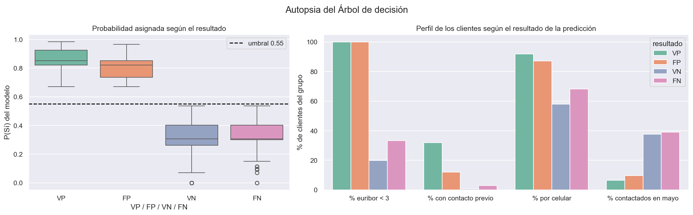

## Contexto

:::: {.columns}
::: {.column width="50%"}
**Problema**

- Las campañas de telemarketing bancario contactan de forma masiva a toda la base de clientes para captar depósitos a plazo.
- La mayoría de los contactados no suscribe: aumenta el costo de la campaña y se generan llamadas innecesarias.
:::

::: {.column width="50%"}
**Dataset**

- *Bank Marketing* (UCI Machine Learning Repository), banco portugués.
- 41,188 registros y 21 columnas, de mayo de 2008 a noviembre de 2010.
- Variable objetivo: `suscribio` (Sí / No).

::: {.destacado}
**Objetivo:** estimar, antes de llamar, si un cliente aceptará el depósito, para priorizar la lista de contactos.
:::
:::
::::

::: {.notes}
Tiempo estimado: 40 s.
:::

## Resumen de la Parte I

:::: {.columns}
::: {.column width="45%"}
**Pasos realizados**

1. **Limpieza:** 12 duplicados eliminados (41,176 registros); valores `unknown` tratados como categoría `desconocido` o imputados con la moda; el código 999 de `dias_previos` separado como "sin contacto".
2. **Nuevas variables:** 5 variables derivadas con reglas simples.
3. **Análisis exploratorio** univariado y multivariado.
:::

::: {.column width="55%"}
**Hallazgos que se usan en la Parte II**

1. **Desbalance:** solo el 11.27% suscribe. Se requiere ponderar las clases y evaluar con F1.
2. **Historial y tasas de interés:** aceptación de 63.83% con contacto previo frente a 9.26% sin él, y de 24.46% con Euribor menor a 3% frente a 4.84%.
3. **Duración de la llamada:** está muy asociada a la aceptación, pero solo se conoce después de la llamada. Se excluye del modelo.
:::
::::

::: {.notes}
Tiempo estimado: 50 s.
:::

## Preparación del dataset

:::: {.columns}
::: {.column width="50%"}
**Selección de variables**

- Excluidas: `duracion` y sus derivadas (fuga de información), `tasa_var_empleo` y `num_empleados` (colineales con `euribor3m`), y variables duplicadas.
- Se conservan **17 variables** conocidas antes de la llamada.

**Codificación y estandarización**

- `.map()` a 1/0 en binarias y `pd.get_dummies` en el resto: **53 columnas**.
- Estandarización de las 6 numéricas, solo para la regresión logística.
:::

::: {.column width="50%"}
**División estratificada 60 / 20 / 20**

| Conjunto | Registros | Aceptan | Tasa |
|---|---:|---:|---:|
| Entrenamiento | 24,705 | 2,783 | 11.26% |
| Validación | 8,235 | 928 | 11.27% |
| Prueba | 8,236 | 928 | 11.27% |

- **Validación:** elegir hiperparámetros y umbral.
- **Prueba:** se usa una sola vez, al final.
:::
::::

::: {.notes}
Tiempo estimado: 60 s.
:::

## Modelos y métricas

| Modelo | Justificación |
|---|---|
| **Árbol de decisión** | Los patrones de la Parte I son cortes (tasa alta o baja, con o sin historial). Sus reglas se pueden leer y explicar. |
| **Regresión logística** | Modelo lineal simple e interpretable. Sirve como punto de comparación. |

- **Desbalance:** `class_weight="balanced"`; cada cliente que acepta pesa unas 7.9 veces más.
- **Métrica de selección:** F1 de la clase "Sí", que combina *precision* (llamadas acertadas) y *recall* (interesados encontrados).
- La *accuracy* no sirve para elegir: responder siempre "No" daría 88.7%.

::: {.notes}
Tiempo estimado: 40 s.
:::

## Ajuste de hiperparámetros y del umbral

:::: {.columns}
::: {.column width="38%"}
**Búsqueda en grilla (16 combinaciones, F1 en validación)**

| Modelo | Elegido | F1 |
|---|---|---:|
| Logística | `C = 10` | 0.454 |
| Árbol | `max_depth = 7`, `min_samples_leaf = 100` | 0.486 |

- Con profundidad 9 el F1 del árbol baja: sobreajuste.

**Umbral de decisión (0.30 a 0.80)**

- Logística: **0.60** (F1 0.476).
- Árbol: **0.55** (F1 0.500).
:::

::: {.column width="62%"}

::: {.nota}
Ambos umbrales son mayores que 0.50 porque `class_weight` eleva las probabilidades de "Sí".
:::
:::
::::

::: {.notes}
Tiempo estimado: 50 s.
:::

## Resultados en el conjunto de prueba

:::: {.columns}
::: {.column width="45%"}
| Modelo | Precision | Recall | F1 |
|---|---:|---:|---:|
| Árbol (0.55) | **0.449** | 0.596 | **0.512** |
| Logística (0.60) | 0.420 | **0.607** | 0.497 |

- El F1 en prueba es similar al de validación: no hay sobreajuste.
- **Sin modelo:** acepta el 11.27% de los clientes llamados.
- **Con el árbol:** se llama al 15% de la lista (1,232 clientes), acepta el **44.89%** y se captan 553 de los 928 interesados.
:::

::: {.column width="55%"}

:::
::::

::: {.notes}
Tiempo estimado: 60 s.
:::

## Variables que usa cada modelo

{height="380"}

- Ambos modelos coinciden: Euribor, historial de contacto y mes.
- El árbol concentra el **82%** de su importancia en `euribor3m`. Sus cortes (4.857, 4.860) identifican semanas específicas de la campaña.

::: {.notes}
Tiempo estimado: 40 s.
:::

## Árbol de decisión: primeros niveles

{height="420"}

::: {.nota}
Primera pregunta: Euribor $\leq$ 1.265%. Rama de tasas bajas: contacto previo y canal. Rama de tasas altas: mes de mayo, número de llamadas y cortes de la Euribor.
:::

::: {.notes}
Tiempo estimado: 30 s.
:::

## Caso clasificado correctamente: decisión paso a paso

:::: {.columns}
::: {.column width="50%"}
**Cliente de prueba:** jubilado de 66 años, éxito previo, celular, marzo, Euribor 0.655%. **Aceptó.**

**Camino en el árbol**

1. `euribor3m` = 0.655 $\leq$ 1.265
2. `euribor3m` = 0.655 $\leq$ 1.092
3. `contacto_previo` = Sí
4. `ipc` = 93.369 > 92.681
5. `dia_semana` distinto de lunes
6. `edad` = 66 > 35.5
7. `campana` = 1 $\leq$ 1.5

Hoja 28: 101 clientes, 89.1% aceptó. P(Sí) = **0.985**.
:::

::: {.column width="50%"}
**Regresión logística**

| Variable | Aporte |
|---|---:|
| `euribor3m` | +1.526 |
| `contacto_previo` | +1.229 |
| `mes=mar` | +1.081 |
| `celular` | +0.393 |
| `resultado_previo=success` | +0.393 |
| `empleo=retired` | +0.374 |

Intercepto $-0.101$; puntaje $z$ = 4.746.

$P(\text{Sí}) = 1/(1+e^{-4.746}) =$ **0.991**
:::
::::

::: {.notes}
Tiempo estimado: 60 s.
:::

## Autopsia: errores del árbol de decisión

:::: {.columns}
::: {.column width="40%"}
| Error | Casos | Consecuencia |
|---|---:|---|
| **Falso positivo** (Tipo I) | 679 | Llamada sin éxito |
| **Falso negativo** (Tipo II) | 375 | Depósito no captado |

- Los errores **no están cerca del umbral**: el modelo no distingue estos clientes de los que clasifica bien.
- **Falsos positivos:** 100% con Euribor < 3%, pero solo 12% con contacto previo.
- **Falsos negativos:** aceptaron en condiciones desfavorables (39% en mayo).
:::

::: {.column width="60%"}

:::
::::

::: {.notes}
Tiempo estimado: 50 s.
:::

## Dos casos fallidos

:::: {.columns}
::: {.column width="50%"}
**Error 2: falso positivo (P(Sí) = 0.97)**

Jubilado de 56 años, contacto previo con resultado **fracaso**, celular, marzo, Euribor 0.644%. **No aceptó.**

- **Hipótesis:** en esa rama el árbol solo pregunta si hubo contacto previo, no cuál fue su resultado.
- **Solución:** combinar `contacto_previo` y `resultado_previo` en una sola variable (sin historial, fracaso, éxito).
:::

::: {.column width="50%"}
**Error 5: falso negativo (P(Sí) = 0.00)**

Empleado de servicios de 52 años, teléfono fijo, mayo, Euribor 4.858%, 5 llamadas. **Aceptó.**

- **Hipótesis:** cae en una hoja que corresponde a una semana de mayo en la que ninguno de 128 clientes aceptó; su motivo no está en los datos.
- **Solución:** reemplazar `euribor3m` por un nivel de tasas (baja o alta) y validar el modelo en el tiempo.
:::
::::

::: {.alerta}
Los cinco errores analizados se concentran en dos hojas: el modelo depende más del **periodo** de la llamada que del **perfil** del cliente.
:::

::: {.notes}
Tiempo estimado: 60 s.
:::

## Comparación y conclusiones

:::: {.columns}
::: {.column width="50%"}
| | Árbol | Logística |
|---|---:|---:|
| F1 (prueba) | **0.512** | 0.497 |
| Falsos positivos | **679** | 777 |
| Falsos negativos | 375 | **365** |

::: {.destacado}
**Modelo elegido: árbol de decisión.** Mejor F1, mayor *precision* con un *recall* similar y reglas legibles.
:::
:::

::: {.column width="50%"}
**Conclusiones técnicas**

- El desbalance obligó a ponderar las clases y ajustar el umbral; aun así, el F1 se mantiene alrededor de 0.5.
- El rendimiento depende del contexto de tasas de 2008 a 2010.

**Mejoras de datos**

- Variables financieras del cliente: saldo, ingresos, endeudamiento y depósitos vigentes.
- Nivel de tasas, meses agrupados en temporadas y validación temporal.
:::
::::

::: {.notes}
Tiempo estimado: 50 s.
:::

## Consideraciones éticas

- **Privacidad:** el dataset contiene datos personales. Aplican el RGPD y, en Perú, la Ley N.º 29733; se requiere consentimiento.
- **Personas vulnerables:** el modelo prioriza a jubilados y adultos mayores. Se debe verificar que el producto sea adecuado para cada cliente.
- **Exclusión:** el modelo debe usarse para **ordenar** a quién llamar primero, no para **negar** el acceso al producto.
- **Costo de los errores:** con el umbral elegido no se encuentra al 40% de los interesados; el banco debe definir ese equilibrio.
- **Supervisión humana y monitoreo:** el modelo puede perder rendimiento si cambia el contexto económico.

::: {.notes}
Tiempo estimado: 40 s.
:::

## Gracias {.center}

::: {.notes}
Tiempo total estimado: 10 min 10 s.
:::
