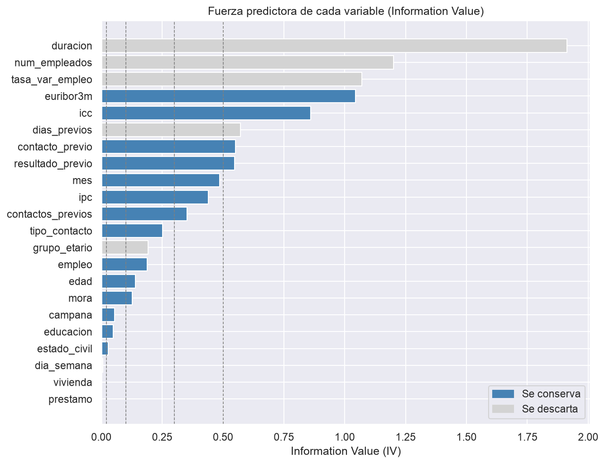
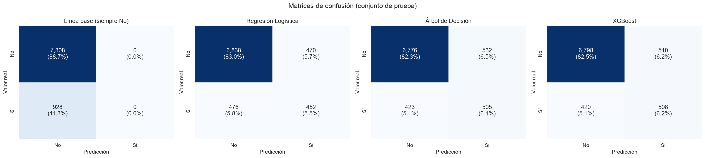
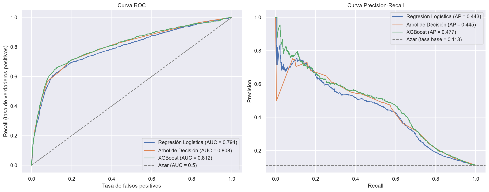
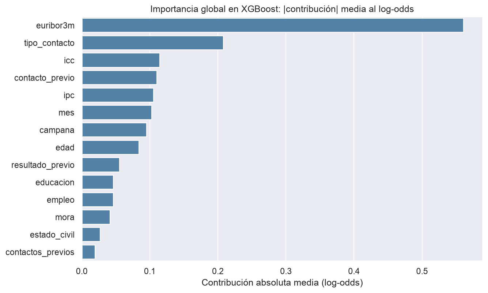
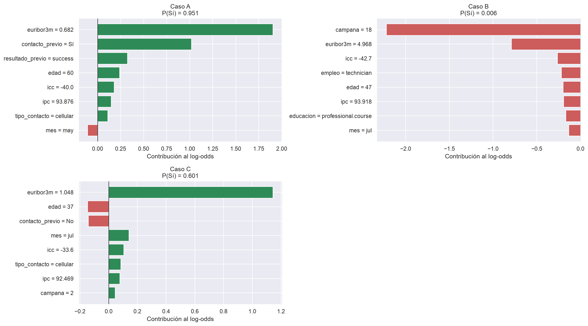
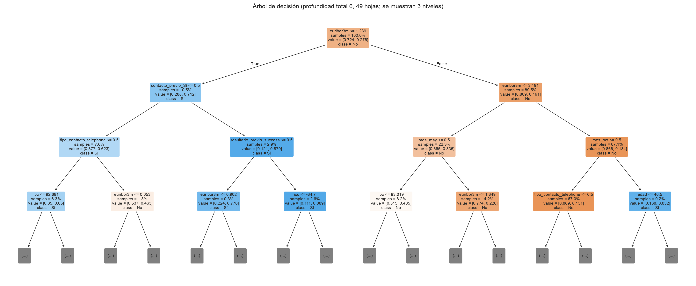
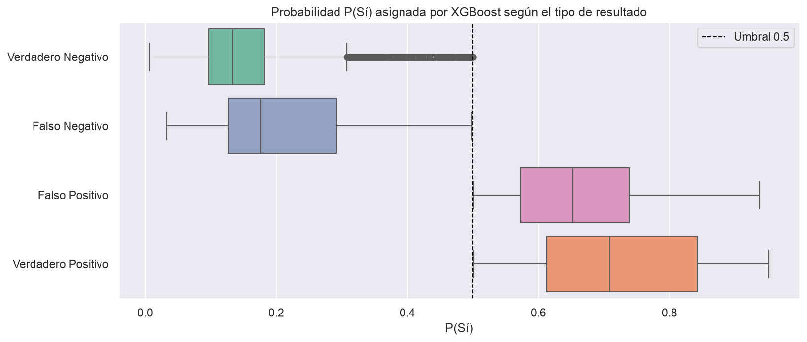
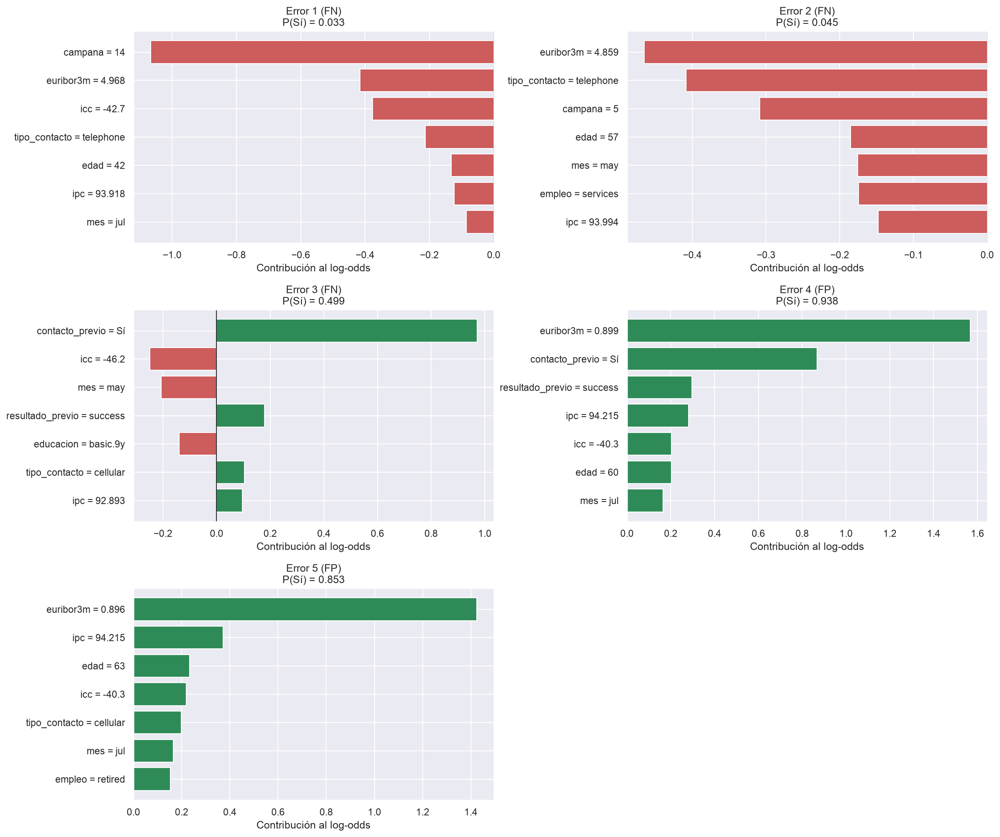
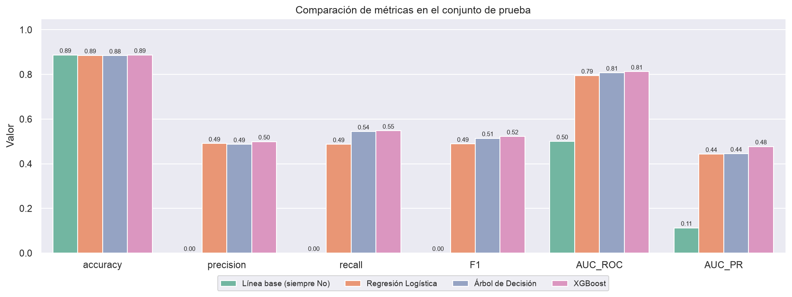

## Del EDA al modelo

:::: {.columns}
::: {.column width="50%"}
**Lo que aprendimos en la Parte I**

- Solo el **11.27%** de los clientes contactados suscribe (ratio 1 : 7.88).
- Las mayores diferencias en la aceptación: **Euribor**, **historial de contacto**, **canal** e **insistencia**.
- `duracion` predice muy bien, pero solo se conoce **después** de la llamada.
:::

::: {.column width="50%"}
**Objetivo de la Parte II**

::: {.destacado}
Estimar, **antes de llamar**, la probabilidad de que un cliente suscriba, para concentrar la campaña en los clientes con mayor propensión.
:::

- Tres modelos: Regresión Logística, Árbol de Decisión y XGBoost.
- Explicar **cómo decide** el mejor modelo.
- Hacer la **autopsia** de sus errores.
:::
::::

# 1. Preparación final del dataset

## Fuerza predictora: Information Value (IV)

:::: {.columns}
::: {.column width="55%"}

:::

::: {.column width="45%"}
**¿Por qué IV?** Es el estándar de *scoring* bancario: mide numéricas y categóricas en la misma escala y capta relaciones **no lineales** (la "U" de la edad).

**Tres reglas de exclusión:**

1. **Fuga de información:** `duracion` (IV = 1.91, el más alto) se descarta.
2. **Colinealidad:** de la tríada Euribor / empleo / n.° empleados (r > 0.9) se conserva solo `euribor3m`. Su VIF baja de **64.3 a 2.7**.
3. **IV < 0.02:** `dia_semana`, `vivienda`, `prestamo`.

**22 candidatas → 14 variables → 46 columnas** tras *one-hot*.
:::
::::

## Codificación, escalado y división

:::: {.columns}
::: {.column width="50%"}
**Preprocesamiento (dentro de un `Pipeline`)**

- **One-hot** para las 8 categóricas: son nominales, un código 1, 2, 3 inventaría un orden.
- **StandardScaler** para las 6 numéricas: la logística regulariza todos los coeficientes por igual.
- El **árbol no se escala**: es invariante a la escala y así sus reglas quedan en unidades reales.
- Todo se ajusta **solo con entrenamiento** → sin fuga hacia la prueba.
:::

::: {.column width="50%"}
**`train_test_split` 80/20 estratificado**

| Conjunto | Registros | Suscripciones | Tasa |
|---|---:|---:|---:|
| Entrenamiento | 32,940 | 3,711 | 11.27% |
| Prueba | 8,236 | 928 | 11.27% |

- **80%:** más positivos para aprender una clase escasa.
- **20%:** 928 positivos bastan (error estándar del *recall* ≈ 1.6 pp).
- **Estratificado:** misma tasa en ambos conjuntos.
- Ajuste con **validación cruzada de 5 particiones**; la prueba se usa **una sola vez**.
:::
::::

# 2. Modelos y razonamiento

## Elección de los modelos

| Modelo | Lógica | Por qué para este problema |
|---|---|---|
| **Línea base** | Predice siempre "No" | Piso mínimo: obtiene 88.7% de *accuracy* sin servir para nada |
| **Regresión Logística** | $p = 1/(1+e^{-(\beta_0+\sum\beta_j x_j)})$ | Estándar bancario, transparente (*odds ratios*); no capta la "U" ni interacciones |
| **Árbol de Decisión** | Preguntas sucesivas hasta una hoja (profundidad ≤ 6) | Reglas legibles para el *call center*; capta no linealidades |
| **XGBoost** | Cientos de árboles en secuencia, cada uno corrige al anterior | Referente en datos tabulares; interacciones, regularización, `scale_pos_weight` |

::: {.destacado}
**Métrica de selección: F1 de la clase "Sí"**, que equilibra la *precision* (eficiencia de las llamadas) y el *recall* (depósitos captados). El *accuracy* no sirve con un 88.7% de "No".
:::

## Ajuste de hiperparámetros

:::: {.columns}
::: {.column width="55%"}
| Modelo | Búsqueda | F1 CV | F1 entren. |
|---|---|---:|---:|
| Logística | Grid (12) | 0.470 ± 0.011 | 0.473 |
| Árbol | Grid (36) | 0.490 ± 0.014 | 0.503 |
| XGBoost | Random (30 de 6,912) | **0.500 ± 0.013** | 0.527 |

- *Random search* en XGBoost: la grilla completa serían 34,560 entrenamientos.
- **Sin sobreajuste:** la brecha entre entrenamiento y CV es de 0.003 a 0.027.
:::

::: {.column width="45%"}
**El desbalance también se ajustó**

Los tres modelos eligieron el mismo peso: **3 : 1** a favor de los "Sí".

- Peso 1 → casi nunca predice "Sí" (*recall* bajo).
- Peso 7.88 → demasiados "Sí" (*precision* baja).
- **3 : 1** → máximo F1.
:::
::::

# 3. Resultados y métricas

## Métricas en el conjunto de prueba

| Modelo | Accuracy | Precision | Recall | **F1** | AUC-ROC | AUC-PR |
|---|---:|---:|---:|---:|---:|---:|
| Línea base (siempre No) | 0.887 | 0.000 | 0.000 | 0.000 | 0.500 | 0.113 |
| Regresión Logística | 0.885 | 0.490 | 0.487 | 0.489 | 0.795 | 0.443 |
| Árbol de Decisión | 0.884 | 0.487 | 0.544 | 0.514 | 0.808 | 0.445 |
| **XGBoost** | **0.887** | **0.499** | **0.547** | **0.522** | **0.812** | **0.477** |

:::: {.columns}
::: {.column width="50%"}
::: {.alerta}
**Paradoja del *accuracy*:** la línea base empata a XGBoost en *accuracy* sin detectar a un solo cliente.
:::
:::
::: {.column width="50%"}
::: {.destacado}
**XGBoost gana en todas las métricas de la clase positiva**, aunque el árbol queda muy cerca (98% de su F1).
:::
:::
::::

## Matrices de confusión

XGBoost detecta **508 de 928** suscriptores (55%) y se equivoca en **510** llamadas: cuando dice "Sí", acierta **1 de cada 2** veces.

## ¿Qué significa para el banco?

:::: {.columns}
::: {.column width="55%"}

:::

::: {.column width="45%"}
Llamar solo a quienes XGBoost marca como "Sí":

12% de las llamadas

55% de los depósitos

× 4.4 conversión

La conversión pasa de **11.3% a 49.9%**. La curva *precision-recall* permite elegir otro umbral según el costo de una llamada y el valor de un depósito.
:::
::::

# 4. Explicabilidad

## Por qué estos hiperparámetros de XGBoost

| Hiperparámetro | Valor | Justificación |
|---|---:|---|
| `n_estimators` × `learning_rate` | 300 × 0.05 | Pasos pequeños y muchos árboles: corrige el error de forma gradual y generaliza mejor |
| `max_depth` | 4 | Interacciones de hasta 4 variables (Euribor × historial × canal × edad) sin memorizar |
| `min_child_weight` | 1 | Permite hojas para segmentos pequeños pero valiosos (éxito previo: 3% de la base, 65% de aceptación) |
| `subsample` / `colsample_bytree` | 0.8 / 0.8 | Cada árbol ve el 80% de filas y columnas: menos varianza y la Euribor no domina todos los árboles |
| `scale_pos_weight` | 3 | Cada "Sí" pesa como 3 clientes: máximo F1 en validación |

::: {.nota}
Para explicar cada predicción usamos las **contribuciones exactas (SHAP)** de XGBoost: valor base + Σ contribuciones = *log-odds* → $P(\text{Sí}) = 1/(1+e^{-z})$. La reconstrucción coincide con `predict_proba()` con un error de 4 × 10⁻⁷.
:::

## ¿En qué se fija el modelo?

:::: {.columns}
::: {.column width="55%"}

:::

::: {.column width="45%"}
- **`euribor3m` domina** (más del doble que la segunda variable).
- Luego: canal, confianza del consumidor, contacto previo, IPC, mes e insistencia.
- Coincide con el EDA → el modelo aprendió patrones reales.

::: {.alerta}
Pero 4 de las 7 variables más importantes describen **cuándo** se llamó, no **a quién**.
:::
:::
::::

## Paso a paso: tres casos bien clasificados

{height="430"}

::: {.nota}
Verde: empuja hacia "Sí"; rojo: empuja hacia "No". Valor base: −0.967 (27.5%, por el peso 3 : 1).
:::

## Caso A: de −0.967 a 95.1%

:::: {.columns}
::: {.column width="50%"}
**Cliente real de X_test (índice 39636):** 60 años, administrativo, casado, celular, mayo, Euribor 0.68%, 2 contactos previos, campaña anterior **exitosa**.

| Paso | Contribución | *z* acumulado |
|---|---:|---:|
| Valor base | −0.967 | −0.967 |
| `euribor3m` = 0.682 | +1.906 | 0.938 |
| `contacto_previo` = Sí | +1.020 | 1.958 |
| `resultado_previo` = success | +0.324 | 2.282 |
| `edad` = 60 | +0.238 | 2.520 |
| Resto (10 variables) | +0.453 | 2.973 |
| **P(Sí) = 1/(1+e^−2.973)** | | **0.951** |
:::

::: {.column width="50%"}
**Caso B** (P(Sí) = 0.006): **18 contactos** restan −2.22 y una Euribor de 4.97% resta −0.79. Ninguna variable empuja a "Sí".

**Caso C** (P(Sí) = 0.601): la Euribor de 1.05% aporta +1.14; **sin ella el resto da P ≈ 0.32 ("No")**.

::: {.alerta}
El acierto del Caso C es frágil: acertó porque el cliente fue llamado **en un buen momento**, no por su perfil.
:::
:::
::::

## El mismo caso en el árbol de decisión

{height="330"}

**Caso A:** `euribor3m` = 0.68 ≤ 1.239 → `contacto_previo` = Sí → `resultado_previo` = success → `icc` = −40 ≤ −34.7 → `euribor3m` ≤ 1.039 → `campana` = 1 ≤ 3.5 → **hoja 38: P(Sí) = 0.926**

::: {.nota}
Dos algoritmos distintos llegan a la misma decisión **por las mismas razones**. La primera pregunta del árbol también es la Euribor.
:::

# 5. Autopsia del modelo

## 930 errores: ¿qué tipo y cuánto cuestan?

:::: {.columns}
::: {.column width="45%"}
| Error | Casos | Significado |
|---|---:|---|
| **Falso Positivo** (Tipo I) | 510 | Llamamos a quien no suscribe: costo de la llamada y **molestia** |
| **Falso Negativo** (Tipo II) | 420 | No llamamos a quien sí suscribiría: **depósito perdido** |

Un falso negativo cuesta más que un falso positivo → conviene un umbral menor a 0.5.
:::

::: {.column width="55%"}

Los falsos negativos tienen un P(Sí) mediano de 0.18, igual que los verdaderos negativos: **el modelo no tiene señal para ellos**.
:::
::::

## ¿Dónde se concentran los errores?

| Segmento | Registros | Tasa real | Predice "Sí" | Recall | FN | FP |
|---|---:|---:|---:|---:|---:|---:|
| Euribor < 3% | 2,670 | 25.4% | 37.6% | 0.74 | 179 | **505** |
| Euribor ≥ 3% | 5,566 | 4.5% | **0.25%** | **0.04** | **241** | 5 |
| Con contacto previo | 308 | 60.7% | 90.3% | 0.98 | 4 | 95 |
| Teléfono fijo | 3,040 | 5.4% | 2.8% | 0.25 | 123 | 43 |

::: {.alerta}
**Hallazgo central:** en el periodo de tasas altas el modelo prácticamente **nunca dice "Sí"** (detecta 9 de 250 suscriptores), y en el de tasas bajas genera el 99% de los falsos positivos. Aprendió **en qué periodo** se suscribía más, no **qué clientes** suscriben.
:::

## Caso fallido 1: falso negativo (P(Sí) = 0.044)

:::: {.columns}
::: {.column width="45%"}
**Cliente:** 57 años, divorciado, servicios, secundaria, **teléfono fijo**, **mayo**, Euribor **4.86%**, sin historial, 5 contactos. **Sí suscribió.**

| Variable | Contribución |
|---|---:|
| `euribor3m` = 4.859 | −0.47 |
| `tipo_contacto` = telephone | −0.41 |
| `campana` = 5 | −0.31 |
| `edad` = 57 | −0.19 |
:::

::: {.column width="55%"}
**Por qué se confundió:** es el perfil exacto de la masa que rechaza (el mayo masivo de 2008). Nada lo distingue.

**Hipótesis:** la decisión dependió de factores **que el dataset no registra** (liquidez reciente, una liquidación, el vencimiento de otro producto). Es el error más común: el 57% de los falsos negativos.

::: {.destacado}
**Solución:** incorporar variables financieras del cliente: **saldo** (la versión *bank-full* de UCI incluye `balance`), ingresos y vencimientos próximos.
:::
:::
::::

## Caso fallido 2: falso positivo (P(Sí) = 0.938)

:::: {.columns}
::: {.column width="45%"}
**Cliente:** jubilado de 60 años, celular, julio, Euribor **0.90%**, 2 contactos previos, campaña anterior **exitosa**, 4 contactos en la actual. **No suscribió.**

| Variable | Contribución |
|---|---:|
| `euribor3m` = 0.899 | +1.57 |
| `contacto_previo` = Sí | +0.87 |
| `resultado_previo` = success | +0.30 |
| `ipc` = 94.215 | +0.28 |
:::

::: {.column width="55%"}
**Por qué se confundió:** tiene el perfil "ideal" en todas las señales.

**Hipótesis:** el éxito previo es **justamente la razón del rechazo**: si ya abrió un depósito, su dinero sigue inmovilizado. Y 4 contactos en esta campaña sugieren que ya había mostrado resistencia.

::: {.destacado}
**Solución:** añadir "tiene un depósito vigente" y su vencimiento, y la interacción **éxito previo × contactos actuales**.
:::
:::
::::

## Más casos analizados en el reporte

{height="400"}

::: {.nota}
Error 1: 14 contactos "castigan" a un cliente que sí suscribió (`campana` no distingue rechazos de llamadas no contestadas). Error 3: indeciso, a 0.001 del umbral → "zona gris". Error 5: casi todo el empuje viene del periodo, no del cliente.
:::

## Prueba de estrés: ¿funciona en el futuro?

El archivo está ordenado en el tiempo (2008 → 2010). Entrenamos con el **primer 80%** y probamos en el **20% más reciente**:

| Validación | Tasa real en prueba | Recall | F1 | AUC-ROC |
|---|---:|---:|---:|---:|
| Aleatoria 80/20 | 11.3% | 0.547 | **0.522** | 0.812 |
| Temporal (pasado → futuro) | **30.8%** | **0.099** | **0.167** | 0.613 |

::: {.alerta}
La tasa de aceptación pasa de **6.4%** (entrenamiento) a **30.8%** (periodo final). Ante el **cambio de régimen económico**, el modelo sigue prediciendo "No" como en 2008. Su F1 de 0.52 solo vale si el futuro se parece al pasado → hay que **validar en el tiempo y reentrenar**.
:::

# 6. Comparación y conclusiones

## Comparación de modelos

:::: {.columns}
::: {.column width="55%"}

:::

::: {.column width="45%"}
| Modelo | Ventaja | Limitación |
|---|---|---|
| Logística | Transparente, estable | No capta la "U" ni interacciones |
| Árbol | 49 reglas legibles, casi iguala a XGBoost | Inestable, probabilidades escalonadas |
| XGBoost | Mejor en todo | Caja negra, probabilidades descalibradas |

**Recomendación:** XGBoost para puntuar + árbol para **comunicar** las razones al *call center*.
:::
::::

## Conclusiones técnicas

1. **El desbalance condicionó todo:** el *accuracy* es engañoso y los tres modelos necesitaron un peso de 3 : 1.
2. **Excluir `duracion` fue clave** para tener un modelo utilizable antes de la llamada.
3. **Conservar los atípicos fue correcto:** 18 contactos aportaron la mayor contribución individual (−2.22).
4. **El límite lo ponen los datos, no el algoritmo:** los tres modelos rinden parecido; la caída temporal es mucho mayor que la diferencia entre ellos.
5. **Mejoras de datos que pide la autopsia:**
   - Saldo, ingresos y productos vigentes del cliente.
   - Resultado de cada intento de contacto.
   - Tasa del depósito menos la Euribor, en lugar de los indicadores absolutos.
   - Validación temporal, umbral según costos y una "zona gris" de revisión humana.

## Conclusiones éticas

:::: {.columns}
::: {.column width="45%"}
| Grupo etario | Tasa real | Seleccionado |
|---|---:|---:|
| 17-24 | 23.4% | 37.4% |
| 35-44 | 9.2% | 7.8% |
| 65 o más | 51.7% | **82.5%** |

La *precision* es similar entre grupos (0.41 a 0.57): no hay sesgo estadístico, pero sí **concentración**.
:::

::: {.column width="55%"}
- **Grupos vulnerables:** el modelo dirige la presión comercial hacia **jubilados y estudiantes** → verificar la **idoneidad del producto** (SBS, MiFID II).
- **Atributos personales:** usar la edad para **priorizar** es razonable; usarla para **negar** productos, no.
- **Insistencia y privacidad:** el modelo reduce las llamadas en un 88%, pero debe mantenerse un **límite de contactos** y el consentimiento (Ley 29733).
- **Supervisión humana y monitoreo:** el modelo puede degradarse en silencio ante un cambio económico.
:::
::::

## Cierre

::: {.destacado}
Con información disponible **antes** de la llamada, XGBoost encuentra el **12%** de la base que concentra el **55%** de los depósitos (**conversión × 4.4**).
:::

::: {.alerta}
Pero gran parte de ese rendimiento viene de reconocer el **periodo económico**, no el **perfil del cliente**.
:::

**La mejora más valiosa no es un algoritmo más complejo, sino mejores datos del cliente y de la gestión de las llamadas, validados en el tiempo.**

 

### ¡Gracias!
